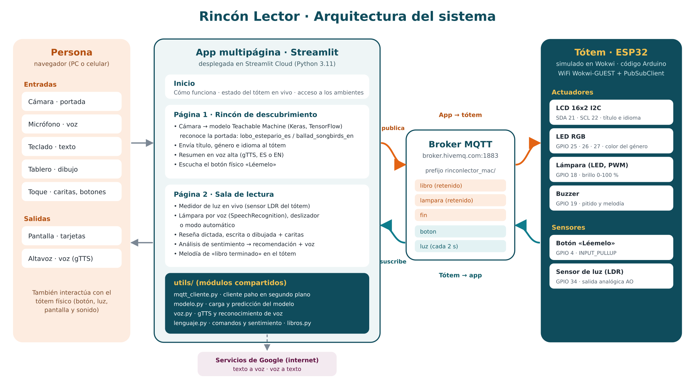
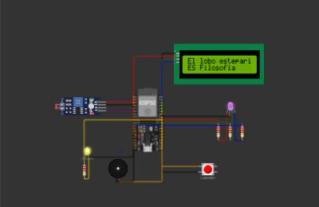
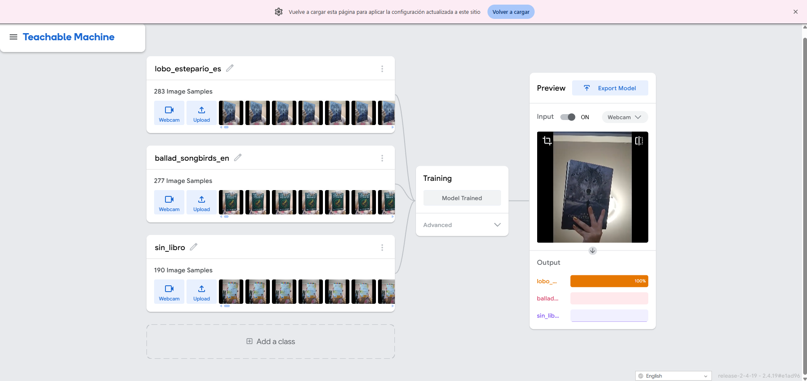
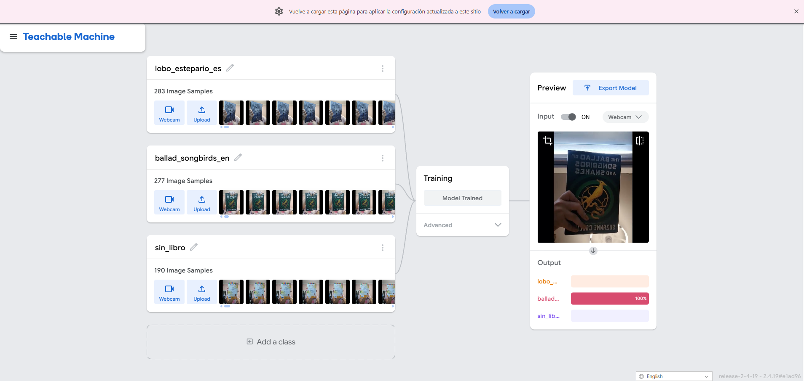
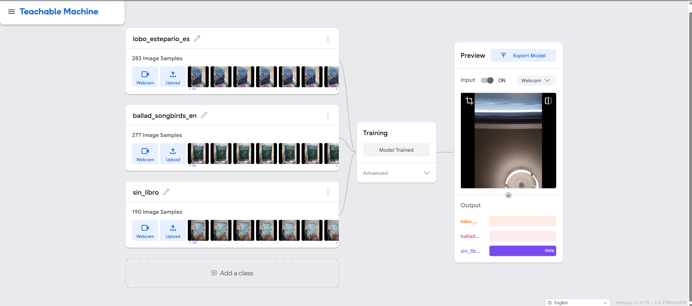

# 📚 Rincón Lector

**Libros que se ven, se escuchan, se dibujan y se sienten.**

Aplicación multimodal que acerca la lectura a niños que empiezan a leer, adultos mayores y personas con baja alfabetización. La persona muestra la portada de un libro a la cámara, un tótem físico se ilumina con el título, y con un botón el libro "le habla". Después puede ajustar la luz de su mesa con la voz y dejar su reseña hablando, escribiendo o dibujando, para recibir una recomendación de su próxima lectura.

Proyecto final · Interfaces Multimodales · María Alejandra Cisneros

| | |
|---|---|
| 🌐 **App en línea** | https://rincon-lector-eecivqsg29tn9mva9x2w48.streamlit.app/ |
| 🔌 **Tótem en Wokwi** | https://wokwi.com/projects/481061636688423937 |

---

## El problema

Los espacios de lectura (bibliotecas, clubes, ferias del libro) suelen dar por hecho que todas las personas leen con fluidez y saben moverse en la tecnología. Quien no puede leer la contraportada no sabe qué libro escoger ni de qué trata, le da pena preguntar y se va sin leer. El Rincón Lector quita esa barrera: el libro se explica solo, en voz alta y con un solo botón. El proyecto se inspira en Medellín Capital del Libro 2027.

## Cómo funciona

1. **Muestra el libro.** La cámara toma la portada y un modelo de Teachable Machine reconoce el libro y su idioma.
2. **El tótem se ilumina.** La pantalla LCD muestra el título y el LED se pone del color del género (morado = filosofía, rojo = distopía).
3. **Aprieta «Léemelo».** El botón físico del tótem le pide a la app que lea el resumen en voz alta, en español o en inglés según el libro.
4. **Ajusta la luz.** En la Sala de lectura, el sensor de luz del tótem mide la mesa y la lámpara se controla por voz («más luz», «luz al 50»), a mano o en modo automático.
5. **Deja tu reseña.** Con una carita, dictando, escribiendo o dibujando. La app analiza si te gustó, te recomienda tu próxima lectura (también en voz alta) y el tótem toca una melodía de «libro terminado».

## Arquitectura



La app de Streamlit y el ESP32 se comunican en ambos sentidos por **MQTT**, a través del broker público `broker.hivemq.com`. El cliente MQTT de la app corre en segundo plano y las páginas consultan su estado cada 2 segundos.

## Dos ambientes, siete modalidades

| Página | Ambiente | Modalidades |
|---|---|---|
| 📚 **Descubrimiento** | El rincón donde se elige el libro | Imagen (cámara + reconocimiento), voz de salida, botón físico del tótem, pantalla y luz del tótem |
| 💡 **Sala de lectura** | La mesa donde se lee y se opina | Voz de entrada (comandos y reseña), texto, dibujo, toque (caritas, interruptor, deslizador), sensor de luz, lámpara y buzzer, voz de salida |

| Modalidad | Entrada / salida | Tecnología |
|---|---|---|
| Imagen | Entrada | `st.camera_input` + modelo Keras de Teachable Machine |
| Voz | Entrada | `st.audio_input` + SpeechRecognition (Google) |
| Voz | Salida | gTTS (español e inglés) |
| Texto | Entrada | `st.text_area` + análisis de sentimiento por palabras clave |
| Dibujo | Entrada | `streamlit-drawable-canvas` |
| Toque | Entrada | Caritas (`st.feedback`), botones, interruptor, deslizador |
| Físico / tangible | Entrada y salida | ESP32: botón, sensor LDR, LCD, LED RGB, lámpara y buzzer |

## Comunicación MQTT

| Tópico | Dirección | Mensaje | Ejemplo |
|---|---|---|---|
| `rinconlector_mac/libro` | App → tótem | `titulo\|genero\|idioma` o `ninguno` (retenido) | `El lobo estepario\|filosofia\|es` |
| `rinconlector_mac/lampara` | App → tótem | brillo de 0 a 100 (retenido) | `80` |
| `rinconlector_mac/fin` | App → tótem | `tocar` | `tocar` |
| `rinconlector_mac/boton` | Tótem → app | `leer` | `leer` |
| `rinconlector_mac/luz` | Tótem → app | luz de 0 a 100, cada 2 s | `76` |

Los mensajes de libro y lámpara se envían **retenidos**: si el tótem se desconecta o se reinicia la simulación, recibe de inmediato el último estado.

## El tótem (ESP32 en Wokwi)

ESP32 programado en Arduino (`wokwi/sketch.ino`), conectado a la red `Wokwi-GUEST`.

| Componente | Pin ESP32 | Función |
|---|---|---|
| LCD 16x2 I2C (0x27) | SDA 21 · SCL 22 | Título del libro (con desplazamiento) e idioma/género |
| LED RGB (cátodo común) | 25 · 26 · 27 | Color del género |
| Botón «Léemelo» | 4 (INPUT_PULLUP) | Pide a la app leer el resumen |
| Sensor de luz LDR (AO) | 34 | Luz ambiente de la mesa |
| LED lámpara | 18 (PWM) | Lámpara de lectura regulable |
| Buzzer | 19 | Pitido del botón y melodía final |



## Reconocimiento de portadas

Modelo de imagen entrenado en [Teachable Machine](https://teachablemachine.withgoogle.com/) con tres clases:

| Clase | Fotos | Libro e idioma |
|---|---|---|
| `lobo_estepario_es` | 283 | *El lobo estepario*, Hermann Hesse (español) |
| `ballad_songbirds_en` | 277 | *The Ballad of Songbirds and Snakes*, Suzanne Collins (inglés) |
| `sin_libro` | 190 | Fondo, manos, otros objetos |

La app solo acepta el resultado si la confianza es de al menos 80 %; si no, le pide a la persona acercar el libro. La clase de cada portada define el idioma del resumen y de la voz.

| El lobo estepario | The Ballad of Songbirds and Snakes | Sin libro |
|---|---|---|
|  |  |  |

## Estructura del repositorio

```
rincon-lector/
├── .streamlit/config.toml        # tema claro de la app
├── app/
│   ├── Inicio.py                 # página de inicio (archivo principal)
│   ├── pages/
│   │   ├── 1_📚_Descubrimiento.py
│   │   └── 2_💡_Sala_de_lectura.py
│   ├── utils/
│   │   ├── mqtt_cliente.py       # conexión MQTT compartida (paho, segundo plano)
│   │   ├── modelo.py             # carga y predicción del modelo de portadas
│   │   ├── voz.py                # texto a voz y voz a texto
│   │   ├── lenguaje.py           # comandos de la lámpara y sentimiento de la reseña
│   │   ├── libros.py             # catálogo, resúmenes y recomendaciones
│   │   └── estilo.py             # estilos (letra y botones grandes)
│   ├── modelo/                   # keras_model.h5 + labels.txt
│   └── requirements.txt
├── wokwi/                        # sketch.ino, diagram.json, libraries.txt, README
├── modelo/                       # copia original del modelo exportado
└── docs/                         # diagrama y capturas de pruebas
```

## Cómo usarlo

1. Abre la [simulación de Wokwi](https://wokwi.com/projects/481061636688423937) y dale ▶️. Espera a que la consola diga `Conectando a MQTT... conectado!` (hay que tener sesión iniciada en Wokwi para que funcione el WiFi).
2. Abre la [app](https://rincon-lector-eecivqsg29tn9mva9x2w48.streamlit.app/) en otra ventana. En **Inicio** debe aparecer «🟢 Tótem conectado».
3. En **Descubrimiento**, permite el uso de la cámara y toma una foto de la portada.
4. Aprieta el botón rojo del tótem en Wokwi (o «Léemelo» en la app) para escuchar el resumen.
5. En **Sala de lectura**, ajusta la lámpara por voz o a mano, y guarda tu reseña.

> Consejo: deja Wokwi y la app en dos ventanas visibles al mismo tiempo. Si la pestaña de Wokwi queda en segundo plano, el navegador la pone lenta.

### Correrlo en local

```bash
git clone https://github.com/phantom1407/rincon-lector.git
cd rincon-lector/app
pip install -r requirements.txt     # Python 3.11
streamlit run Inicio.py
```

En Streamlit Cloud el archivo principal es `app/Inicio.py` y la versión de Python es 3.11 (TensorFlow 2.15 no funciona con versiones más nuevas).

## Tecnologías

Streamlit · TensorFlow / Keras · Teachable Machine · paho-mqtt · HiveMQ · gTTS · SpeechRecognition · streamlit-drawable-canvas · Pillow · ESP32 (Arduino) · PubSubClient · LiquidCrystal I2C · Wokwi

Los resúmenes y recomendaciones de los libros fueron escritos para este proyecto; no reproducen texto de las obras.
